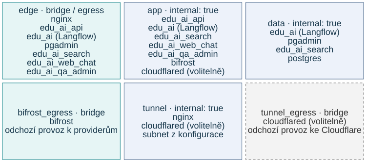

# Zapojení komponent, sítě a fungování

Čtecí kontrola zdrojů na kandidátu `8296f2f` dne 11. 10. 2026. Obrázky popisují základní
`docker-compose.yml` a logiku retrieval služby. Konkrétní běžící VM ani externí perimetr
se tímto dokumentem neověřují. Návrat na [rozcestník dokumentace](../README.md).

## Zapojení komponent

[PNG](diagrams/components.png) · [editovatelný Mermaid zdroj](diagrams/components.mmd)

Plné šipky ukazují implementovaná volání ve zdrojové konfiguraci. Přerušované šipky patří
volitelnému profilu `cloudflare`; konkrétní hostname a Cloudflare Access spravuje provozovatel.
Nejde o automaticky zapnutou cestu při čisté instalaci.

- Nginx směruje HTTP. Web chat volá search přes svůj BFF; QA portál čte přes search a publikuje přes ingest API.
- Ingest API vybere Langflow flow pro zdrojový typ. Registr uživatele, entity a číselníky ověřuje
  přes HTTP ve službě search; nemá přímý přístup do PostgreSQL ani DB heslo.
- Langflow zapisuje obsah do EDU-AI DB a stav do oddělené Langflow DB. Search vyhledává v QA
  a dokumentech; dotazový log a idempotence mají vlastní zápisy.
- Langflow i search používají v základním Compose OpenAI kompatibilní endpoint Bifrostu.
  Skutečný provider, klíče a případné další rerankery určuje konfigurace.
- Mobilní APP je samostatný projekt. Obrázek neslibuje ověřené přímé propojení APP s RAG
  ani dokončený offline QA engine; viz [QA/offline audit](../integrations/offline-qa-rules.md).

## Sítě Docker Compose

[PNG](diagrams/networks.png) · [editovatelný Mermaid zdroj](diagrams/networks.mmd)

Každá buňka uvádí celou sadu členů sítě; služba může být v několika sítích zároveň.
Tyrkysové buňky mají běžný bridge s odchozí trasou, modré mají `internal: true`.
Šedá se používá s volitelným profilem. Základní instalace má devět služeb na pěti použitých
sítích; Compose definuje i šestou `tunnel_egress` pro cloudflared.

| Síť | Členové | Význam |
|---|---|---|
| `edge` | nginx, edu_ai_api, edu_ai, pgadmin, edu_ai_search, edu_ai_web_chat, edu_ai_qa_admin | Upstreamy nginx a odchozí přístup aplikací; není zde jen nginx. |
| `app` | edu_ai_api, edu_ai, edu_ai_search, edu_ai_web_chat, edu_ai_qa_admin, bifrost; volitelně cloudflared | Interní volání aplikací. |
| `data` | postgres, edu_ai, pgadmin, edu_ai_search | Interní databázová síť; nginx, ingest API, chat a QA portál zde nejsou. |
| `bifrost_egress` | bifrost | Odchozí přístup gateway k providerům a provozním endpointům. |
| `tunnel` | nginx; volitelně cloudflared | Interní společný hop; subnet z `EDU_AI_TUNNEL_SUBNET` vymezuje důvěru `CF-Connecting-IP`. |
| `tunnel_egress` | volitelně cloudflared | Odchozí přístup ke Cloudflare. |

Členství vychází ze skutečných `services.*.networks`. Síť `internal` sama neurčuje oprávnění
uživatele ani firewall hostitele. Služby na `edge` mají v základním Compose také odchozí trasu;
obrázek tedy neslibuje, že veškerý internetový provoz prochází Bifrostem.

## Porty a perimetr

[PNG](diagrams/perimeter.png) · [editovatelný Mermaid zdroj](diagrams/perimeter.mmd)

Plné cesty jsou definované ve stacku. Přerušované cesty vyžadují volitelný Cloudflare profil
a externí hostname/Access politiku. VPN, firewall, TLS a Access jsou mimo Compose;
jejich přítomnost obrázek nepovažuje za ověřenou.

| Vstup | Směrování v základním Compose |
|---|---|
| Host `80` → nginx `80` | `/search/`, `/api/`, `/chat/`, `/qa/`, `/qa-api/v1/` a lokální health nginx. |
| Host `8443` → nginx `8443` | `/pgadmin/`; port neznamená automaticky TLS. |
| Host `8444` → nginx `8444` | Langflow UI na `/`; port neznamená automaticky TLS. |
| Výchozí `127.0.0.1:8099` → Bifrost `8080` | Správa gateway; bind a port určuje `BIFROST_BIND` / `BIFROST_PORT`. Bifrost nemá vlastní autentizaci. |
| Interní nginx `81` | Allowlist `/search/`; není publikovaný na hostu. Cloudflared jej dosahuje přes `tunnel`. |

Nginx na portu 81 nepřidává obecné přihlášení; cesta je omezená allowlistem.
`/api/`, chat a QA portál na portu 80 spoléhají na omezený externí perimetr.
Langflow a pgAdmin mají vlastní přihlášení. Viz [nginx konfigurace](../../nginx/conf/nginx.conf)
a [sdílený search include](../../nginx/conf/search_api.conf).

Lokální `docker-compose.override.yml` navíc publikuje backendy na loopbacku:
API 8080, Langflow 7860, PostgreSQL 5432, pgAdmin 5050, search 8090 a web chat 8081.
Obrázky zobrazují základní Compose; automatický dev override je při čtení konkrétního
nasazení potřeba zohlednit.

### Zjištěný rozpor starších podkladů

Hlavička Compose a komentář dev override tvrdí, že na hostu jsou jen tři porty nginx.
Skutečná sekce Bifrostu navíc publikuje výchozí loopback 8099. Starší komentář nginx uvádí
cloudflared na `edge`, ale aktuální Compose používá `app`, `tunnel` a `tunnel_egress`.
Jde o drift komentářů; obrázky vycházejí z konfigurace a rozpor je zde výslovně uvedený.
Lokální obrázek topologie z 27. 8. 2026 není součástí tohoto Git checkoutu a není autoritou
pro dnešní sítě a Bifrost port. Runtime konfigurace se tímto úkolem nemění.

## Jak se vyřídí QA/RAG dotaz

[PNG](diagrams/query-flow.png) · [editovatelný Mermaid zdroj](diagrams/query-flow.mmd)

**Executor provádí jeden krok za iteraci, v pořadí aktivní konfigurace; kroky neběží paralelně.**
Živou kaskádu určuje `executor.py` a `settings.config.pipeline` organizace, nikoli referenční
`graph.py`. Bez organizačního profilu se vybírá globální profil a pak zdrojový fallback.
Enabled, prahy, `on_hit` a podmínky mění konkrétní cestu. Dokumentové kroky a QA vector
se mohou v pipeline prolínat; diagram žádné univerzální pořadí všech retrieverů nezavádí.

1. API validuje entitu, volajícího, oblasti a roli před retrieval. Idempotentní replay vrací
   uloženou odpověď. `resolve_context` může přepsat navazující dotaz nebo vyřešit reakci;
   `prepare` sestaví tokenové formy.
2. Executor vybere další povolený krok se splněnými podmínkami. Route řeší guard a scope packů.
   Obsahové dotazy používají `scope.py` pro entitu, viditelnost, roli a oblasti;
   dokumentové cesty přidávají aktivní/platnostní filtry.
3. Jistý QA hit (`qa_exact`, lexical A či úspěšný `qa_vector`) vrací autorskou odpověď.
   Pro ni se negeneruje odpověď z dokumentů; vector přitom může potřebovat embedding.
   Kaskáda končí při `resolved`, pokud `on_hit` není `continue`; výchozí hodnota je `stop`.
4. Lexical B a typo návrhy se ukládají do `deferred_suggest`. Neřeší dotaz terminálně:
   executor pokračuje dalším krokem, aby dokumenty mohly dodat lepší odpověď.
   Slabší fallback nabídky nejsou totéž co B.
5. Gatherers pouze přidávají kandidáty do poolu. `answer` skládá kontext, pořadí a případný
   rerank; při dostatečných podkladech generuje odpověď s citacemi. Související otázky
   může doplnit včetně odložených návrhů.
6. Bez odpovědi se vrací odložené `suggest`, jinak `no_answer`. Při selhání answer modelu
   má odložené `suggest` opět přednost, jinak jde o `llm_unavailable`.
   Nevyřešenou vyčerpanou pipeline uzavírá bezpečnostní fallback executoru. Pokud je stav
   už resolved (například po posledním kroku s on_hit continue), executor jej vrací beze změny.

Diagram ukazuje synchronní `/v1/ask`. Stream varianta používá stejný retrieval stav; při
dosažení `answer` může executor zastavit před tímto krokem a generování streamuje server.
Dřívější QA/guard výsledek se vrací přímo.

Normálně zpracovaný dotaz se zapisuje do query logu na pozadí; idempotentní výsledek server
ukládá při sestavení odpovědi. Nejde o slib nového retrieval či logu pro každý replay nebo
odmítnutí. Chyba registrovaného pipeline kroku je zachycená a executor pokračuje;
diagram neprohlašuje, že libovolná chyba API či inicializace nemůže selhat.

Detail: [retrieval služba](system.md), [nastavení](../SETTINGS_REFERENCE.md),
[routing](../ai/routing.md), [dokumentové vyhledávání](../ai/retrieval.md) a
[QA pravidla a offline audit](../integrations/offline-qa-rules.md). Starší
[QA fast-path](../ai/qa-fastpath.md) již upozorňuje na drift; popis B jako okamžitého stopu zde nepřebíráme.

## Stav pro zálohu

| Úložiště základního Compose | Obsah |
|---|---|
| `postgres_data` | EDU-AI data, nastavení, registry a samostatná Langflow DB. |
| `langflow_data/` | Konfigurační a souborový stav Langflow; zachování klíče je důležité pro obnovu. |
| `bifrost_data/` | Provider konfigurace a klíče v config DB, provozní log DB. |
| `pgadmin_data` + `pgadmin_exports/` | Účty/nastavení pgAdmin a exporty. |
| `uploads/` | Nahrané soubory gateway. |
| `sqllite_export/` | SQLite QA exporty Langflow. |
| `qa_admin_state` | Dočasný stav preview/importů/exportů QA portálu. |
| `reranker_models` | Cache modelů; není zdrojem školních dat. |
| Soukromá `.env` a instalační config | Přístupové údaje, šifrovací klíče a parametry nasazení. |

Tabulka je mapa stavu, nikoli nový postup podporované produkční obnovy. Úplnost a konzistenci
konkrétní zálohy prokazuje samostatný backup/update/restore průchod;
ověření konkrétního vydání popisuje [RELEASING.md](../RELEASING.md).

## Úpravy obrázků

Primární zdroje jsou `diagrams/*.mmd`; SVG a PNG jsou vygenerované výstupy.
Při změně regenerujte oba formáty a zkontrolujte je vizuálně. Použitý renderer:
Mermaid 11.12.1, Playwright a Chrome; nepřibyla produkční závislost.
Postup a volitelný helper: [renderování diagramů](../tools/architecture-diagrams.md).
