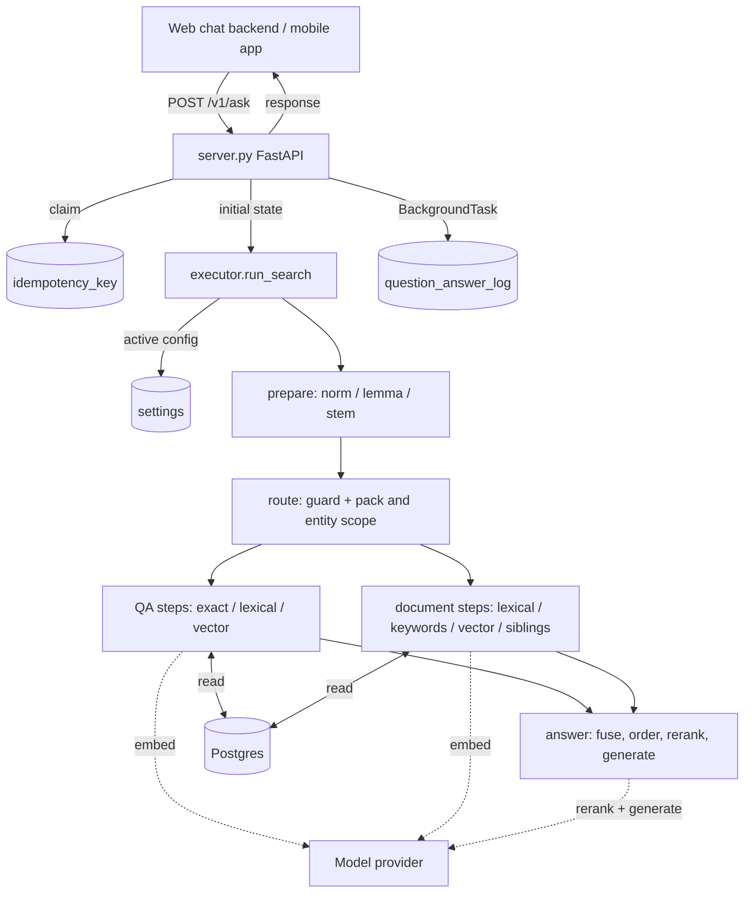

# System architecture — RAG module

**Track:** human. Component map, boundaries and data flow of the retrieval
service. For behaviour detail see [../ai/](../ai/); for interfaces see
[../../contracts/](../../contracts/).

## What this module is

A single FastAPI service that answers one question at a time by walking a
deterministic QA→RAG cascade over Postgres, calling a model provider for
embeddings, for reranking and for the one generation call.

It does **not** ingest content — that is the Langflow ingestion module — and it
has no user interface; the web-chat backend and the mobile app are separate.

## Data flow

**Textual equivalent:** `server.py` receives the request, claims an idempotency
key if one was sent, builds the initial state and calls `executor.run_search`.
The executor loads the active `settings` row for the caller's organisation, runs
`prepare` to build the query's token forms, then walks the configured pipeline:
the `route` guard with pack and entity scope, the curated QA steps (exact →
lexical → vector) and the document steps (full text → keywords → vector →
siblings), ending at `answer`, which fuses the pool, orders it by tiers, reranks
it and makes at most one generation call. Every step reads Postgres. The response
is returned synchronously; one analytics row is written to
`question_answer_log` as a fire-and-forget background task after the response has
been sent.

## Components

| Component | Path | Responsibility |
|---|---|---|
| HTTP API | `search/app/server.py` | the ask, code-list, diagnostic and ingest-status endpoints; request and response models; background logging |
| Executor | `search/app/executor.py` | config-driven pipeline walk, step registry, per-step isolation, the no-answer safety net |
| Settings | `search/app/settings.py` | resolve and cache the active configuration per organisation; inject the stop list |
| Scope | `search/app/scope.py` | the single enforcement point for entity, visibility and role |
| State | `search/app/state.py` | the typed state that flows through the nodes |
| Idempotency | `search/app/idempotency.py` | claim and replay cache for repeated requests |
| Router | `search/app/nodes/route.py` | guard plus pack and entity scope |
| Follow-ups | `search/app/nodes/resolve_context.py` | rewrite an elliptical follow-up before the token forms are built |
| QA nodes | `search/app/nodes/qa_*.py`, `qa_common.py` | curated matching, synonyms, thresholds |
| Document nodes | `search/app/nodes/document_*.py`, `rag_*.py` | full text, keywords, vectors, neighbouring chunks |
| Answer | `search/app/nodes/answer.py`, `answer_generator.py` | fusion, tier ordering, reranking, context assembly, generation |
| Reranking | `search/app/rerank.py` | one contract over the reranker backends |
| Topical gate | `search/app/topical.py` | admission by informative overlap |
| Wording | `search/app/messages.py`, `search/app/languages.py` | messages and labels per language, from the database |
| Normalization | `search/app/text_norm.py` + the `eduai_normalize` package | token forms under the parity contract |
| DB and logging | `search/app/db.py`, `search/app/log.py` | connection pool, append-only query log |

## Boundaries

- **Inbound:** HTTP only, through the reverse-proxy edge with API-key auth, or
  from the in-cluster chat backend. The contract is
  [../../contracts/openapi.yaml](../../contracts/openapi.yaml).
- **Postgres:** the retrieval path reads. The service writes in exactly two
  places — an append-only row per query in `question_answer_log`, and the claim
  and result rows of `idempotency_key`. **The query path performs no updates to
  content**, so an answer can never be rewritten after the fact.
- **Model provider:** embeddings, the rerank judge or prefilter, and one
  generation call per answered question.
- **The ingestion gateway has no database access**, which is why this module owns
  query logging.

## Two cascade representations, one of them live

The **live** path is the config-driven `executor.run_search`, which `server.py`
imports. `search/app/graph.py` builds an equivalent hard-coded state graph of the
same stages; it is kept as a readable reference and is **not** on the request
path. If the two disagree, the executor and the active configuration win — report
the drift rather than silently reconciling it (see
[../../AGENTS.md](../../AGENTS.md), source precedence).

## Configuration lives in the database, not in the image

The image carries code; behaviour comes from the `settings` row, the prompt
registry and the code lists. Connectivity and secrets come from the environment.
The practical consequence is that reading the code does not tell you what the
system does — the active configuration does. It is documented in
[../SETTINGS_REFERENCE.md](../SETTINGS_REFERENCE.md).

## Deployment

A baked image, run under docker-compose. The application directory is not mounted,
so a code change needs a rebuild — but a configuration change does not, and takes
effect within the settings cache TTL.
