# System architecture — RAG module

**Track:** human. Component map, boundaries and data flow of the retrieval
service. For deployment wiring, networks and ports see [deployment.md](deployment.md).
For behaviour detail see [../ai/](../ai/); for interfaces see [../../contracts/](../../contracts/).

## What this module is

A single FastAPI service that answers one question at a time by walking a
configuration-driven QA/RAG cascade over Postgres. Depending on the reached
steps, it calls model providers for embeddings, reranking or answer generation;
a curated QA answer is returned without answer generation.

It does **not** ingest content — that is the Langflow ingestion module — and it
has no user interface; the web-chat backend and the mobile app are separate.

## Data flow

[Editable Mermaid](diagrams/query-flow.mmd) · [PNG](diagrams/query-flow.png)

**Diagram audit 2026-10-11:** the executor runs one configured step at a time.
A resolved QA hit returns a curated answer when `on_hit` is stop/default;
lexical B parks suggestions and continues. This is not a fixed ordering or a
deployed mobile-app connection. The original full-page verification date is retained.

**Textual equivalent:** `server.py` receives the request and resolves the scope
once, in `_prepare_search`, shared by `/v1/ask`, `/v1/ask/stream` and
`/v1/explain`: the entity (an unknown one is a 400), the caller (403 for an
unbacked `user_id`), the thematic **areas** — validated against the school's
DOMAIN catalog and expanded to taxonomy ids, 422 or 503 on failure — and then
the role gate. That order matters and is asserted by tests: areas are resolved
BEFORE the idempotency claim, so a rejected request leaves no claim behind, and
before the role gate, so the early `role_required` answer reports a filter that
really was checked. Then it claims an idempotency key if one was sent, builds
the initial state and calls `executor.run_search`.
The executor loads the active `settings` row for the caller's organisation, runs
`prepare` to build the query's token forms, then walks the configured pipeline:
the `route` guard with pack, entity and area scope, the configured QA and document steps in their actual configured order. Exact,
lexical-A and vector QA hits return author-written answers directly; no document
answer generation is needed for that result. Lexical-B suggestions are deferred
and the executor continues. Gatherers only fill a chunk pool; if reached, `answer`
fuses it, orders it by tiers, optionally reranks and generates from the evidence.
`on_hit` and each step's run conditions determine when the walk stops. Every query that can produce an answer
or a suggestion carries both predicates — identity from `scope.where` and areas
from `scope.domain_where`, ANDed, the second never able to widen the first. Retrieval steps read Postgres. A normally processed response
is returned synchronously; its analytics row is written to
`question_answer_log` as a fire-and-forget background task after the response has
been sent.

## Components

| Component | Path | Responsibility |
|---|---|---|
| HTTP API | `search/app/server.py` | the ask, code-list, diagnostic and ingest-status endpoints; request and response models; background logging |
| Executor | `search/app/executor.py` | config-driven pipeline walk, step registry, per-step isolation, the no-answer safety net |
| Settings | `search/app/settings.py` | resolve and cache the active configuration per organisation; inject the stop list |
| Scope | `search/app/scope.py` | the single enforcement point for entity, visibility and role — plus `domain_where`, the thematic-area fragment, which is a separate predicate ANDed onto it and can only narrow |
| Area resolver | `search/app/domain_scope.py` | normalise the requested DOMAIN codes, validate them against the school's own catalog, expand them to every active taxonomy id the organisation may have labelled with |
| State | `search/app/state.py` | the typed state that flows through the nodes |
| Idempotency | `search/app/idempotency.py` | claim and replay cache for repeated requests |
| Router | `search/app/nodes/route.py` | guard plus pack, entity and area scope |
| Follow-ups | `search/app/nodes/resolve_context.py` | rewrite an elliptical follow-up before the token forms are built |
| QA nodes | `search/app/nodes/qa_*.py`, `qa_common.py` | curated matching, synonyms, thresholds |
| Document nodes | `search/app/nodes/document_*.py`, `rag_*.py` | full text, keywords, vectors, neighbouring chunks |
| Answer | `search/app/nodes/answer.py`, `answer_generator.py` | fusion, tier ordering, reranking, context assembly, generation |
| Reranking | `search/app/rerank.py` | one contract over the reranker backends |
| Topical gate | `search/app/topical.py` | admission by informative overlap |
| Wording | `search/app/messages.py`, `search/app/languages.py` | messages and labels per language, from the database |
| Normalization | `search/app/text_norm.py` + the `eduai_normalize` package | token forms under the parity contract |
| DB and logging | `search/app/db.py`, `search/app/log.py` | connection pool, append-only query log |

## Boundaries

- **Inbound:** HTTP only, either through the reverse-proxy edge or from the
  in-cluster chat backend. **Neither authenticates the caller.** The edge only
  decides which paths exist (`$search_path_allowed`); the perimeter sits outside
  this module entirely — a Cloudflare Access policy on the tunnel hostname and
  the AWS security group on the VPN-only ports, watched from off-site by
  `scripts/perimeter_check.py`. This said "with API-key auth" until 2026-09-02,
  and the key it referred to is gone. The contract is
  [../../contracts/openapi.yaml](../../contracts/openapi.yaml).
- **Postgres:** the retrieval path reads. The service writes in exactly two
  places — an append-only row per query in `question_answer_log`, and the claim
  and result rows of `idempotency_key`. **The query path performs no updates to
  content**, so an answer can never be rewritten after the fact. The separate internal-only router
  `/internal/qa-admin` (`search/app/qa_admin.py`, used by the QA portal, not by queries) does write QA entries,
  embeddings and code lists.
- **Model provider:** embeddings, an optional rerank judge or prefilter, and
  generation when the document answer path is reached. QA hits do not generate
  their author-written answer.
- **The ingestion gateway has no database access**, which is why this module owns
  query logging.

## Two cascade representations, one of them live

The **live** path is the config-driven `executor.run_search`, which `server.py`
imports. `search/app/graph.py` builds a reference hard-coded state graph of the
same stage types; it is kept as a readable reference and is **not** on the request
path. If the two disagree, the executor and the active configuration win — report
the drift rather than silently reconciling it (see
[../../AGENTS.md](../../AGENTS.md), source precedence).

## Configuration lives in the database, not in the image

The image carries code; behaviour comes from the `settings` row, the prompt
registry and the code lists. Connectivity and secrets come from the environment.
The practical consequence is that reading the code does not tell you what the
system does — the active configuration does. It is documented in
[../SETTINGS_REFERENCE.md](../SETTINGS_REFERENCE.md).

## Deployment

A baked image, run under docker-compose. The application directory is not mounted,
so a code change needs a rebuild — but a configuration change does not, and takes
effect within the settings cache TTL.
